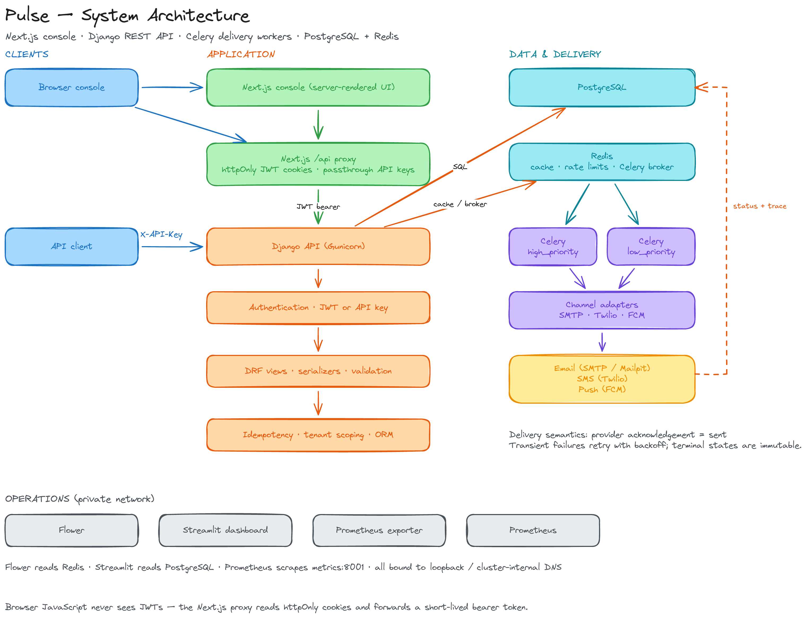
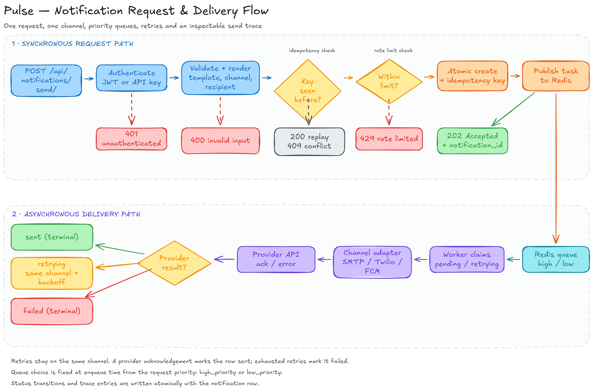
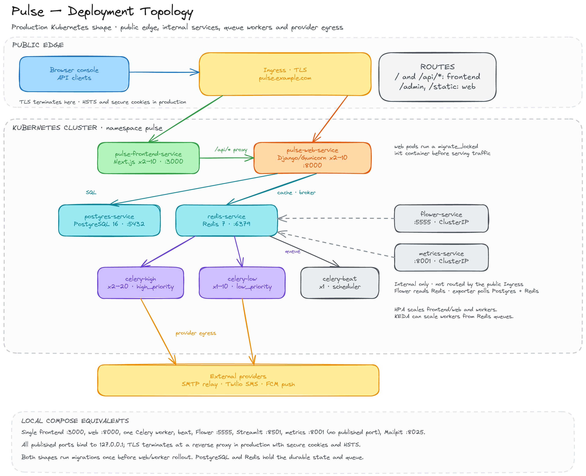

<p align="center">
  
</p>

<h1 align="center">🔔 Pulse</h1>

<p align="center">
  <strong>A self-hosted, inspectable notification service</strong><br>
  Django · Celery · Redis · PostgreSQL · Next.js
</p>

<p align="center">
  
  
  
  
</p>

---

Pulse accepts a notification request, persists it, routes it to a high- or
low-priority queue, and sends it through SMTP, Twilio or Firebase Cloud
Messaging / console push. Every accepted send keeps its request fingerprint,
latest provider response or error, attempt count and final status.

It does **not** claim automatic channel fallback, a dead-letter queue, SSO/SCIM,
an SLA or human delivery receipts. See
[known limitations](docs/known_limitations.md) for the exact boundaries.

## Features

- **Email, SMS and push** through explicit per-request channel selection.
- **Idempotency when a key is supplied**, enforced by a unique database
  constraint; duplicate requests return the existing notification, conflicting
  reuse returns `409`.
- **Priority queues** (`high_priority`, `low_priority`) selected by explicit
  priority or configurable OTP-like template keywords.
- **Bounded retries** with exponential backoff and jitter on the same channel.
- **Atomic delivery claims** and terminal `sent`/`failed` statuses prevent
  concurrent duplicate sends and final-state overwrites. Delivery stays
  at-least-once: a worker crash between the provider acknowledgement and the
  status write can still cause a duplicate provider attempt.
- **Tenant-scoped reads**: API keys and non-staff users see only their own rows;
  staff see the installation.
- **JWT + API-key authentication**, fail-closed, with Redis-backed send limits.
- **Next.js console** for dispatch, delivery traces, routing and windowed
  metrics; JWTs stay in httpOnly cookies.
- **Prometheus exporter**, Flower and a Compose-only Streamlit dashboard for
  operations.

## Architecture



_Editable source: [system-architecture.excalidraw](docs/diagrams/system-architecture.excalidraw)._

The frontend is the browser entry point. Django is internal in Kubernetes and
bound to loopback in Compose. Browser requests to `/api/*` are proxied with the
access token from an httpOnly cookie; direct API clients send an API key.

## Screenshots

The public site and console use one responsive design system.

[](docs/images/web-landing.png)

| Delivery health                                                                              | Dispatch composer                                                                     |
| -------------------------------------------------------------------------------------------- | ------------------------------------------------------------------------------------- |
| [](docs/images/web-dashboard.png) | [](docs/images/web-composer.png)    |
| **Overview** — volume, provider success, p95 latency, queues and recent sends.               | **Composer** — one request, one channel, with a live preview.                         |
| [](docs/images/web-deliveries.png)            | [](docs/images/web-gateways.png) |
| **Deliveries** — searchable log with a send trace.                                           | **Gateways** — provider adapters, queues and retry policy.                            |

Screenshots use a local instance with local test deliveries. Panels show
**Sample** only when a live request fails; they do not silently invent traffic.
See the [web console tour](docs/frontend.md) for sign-in, pricing and mobile
views.

## Quick Start

### Prerequisites

- Docker and Docker Compose
- Git

### 1. Configure

```bash
git clone https://github.com/JathinShyam/Pulse.git
cd Pulse
cp .env.example .env
```

Edit `.env` and replace at least:

```dotenv
SECRET_KEY=<long random value>
POSTGRES_PASSWORD=<database password>
PULSE_API_KEYS=<comma-separated client keys>
ALLOWED_HOSTS=localhost,127.0.0.1,web
```

Leave provider credentials empty to start with Mailpit email and simulated
push. SMS requests will fail permanently with a clear provider-not-configured
error until Twilio is set.

### 2. Start

```bash
docker compose up --build -d
docker compose exec web python manage.py createsuperuser
```

The one-shot `migrate` service applies migrations before the web and worker
services start. Static files are baked into the backend image.

Open <http://localhost:3000> and sign in with the operator account. Mailpit is
at <http://localhost:8025>.

### 3. Create a template

Templates use Python `str.format` placeholders (`{name}`), not Jinja syntax.

```bash
docker compose exec web python manage.py shell -c "
from notifications.models import NotificationTemplate
NotificationTemplate.objects.get_or_create(
    name='welcome_email',
    defaults=dict(
        channel='email',
        subject='Welcome, {name}',
        body_template='Hello {name}, welcome aboard!',
    ),
)
"
```

### 4. Send a notification

Use a key from `PULSE_API_KEYS`:

```bash
export PULSE_API_KEY='replace-with-your-key'

curl -X POST http://localhost:8000/api/notifications/send/ \
  -H "Content-Type: application/json" \
  -H "X-API-Key: $PULSE_API_KEY" \
  -d '{
    "user_id": "user_123",
    "template_name": "welcome_email",
    "to": "user@example.com",
    "context": {"name": "Ada"},
    "idempotency_key": "welcome-user_123"
  }'
```

```json
{
  "notification_id": "550e8400-e29b-41d4-a716-446655440000",
  "status": "queued"
}
```

A `202` means the row was persisted and queued. It does not mean delivered.
Reuse the same idempotency key and payload to retrieve the existing row; reuse
it with a different payload to get `409`.

### 5. Inspect

```bash
curl -H "X-API-Key: $PULSE_API_KEY" \
  http://localhost:8000/api/notifications/status/<notification_id>/

curl -H "X-API-Key: $PULSE_API_KEY" \
  'http://localhost:8000/api/notifications/list/?limit=10'
```

## Services and Ports

| Service             | URL                                               | Notes                            |
| ------------------- | ------------------------------------------------- | -------------------------------- |
| Web console         | <http://localhost:3000>                           | Next.js site and console         |
| Django API          | <http://localhost:8000>                           | Direct API, API-key/JWT auth     |
| Swagger / ReDoc     | <http://localhost:8000/api/docs/> · `/api/redoc/` | Public when `ENABLE_DOCS=True`   |
| Mailpit             | <http://localhost:8025>                           | Local email UI                   |
| Flower              | <http://localhost:5555>                           | Bound to loopback; internal tool |
| Streamlit dashboard | <http://localhost:8501>                           | Bound to loopback; internal tool |
| Prometheus exporter | `metrics:8001/metrics`                            | Not published by Compose         |

Compose binds every published port (frontend `3000`, Django `8000`, Mailpit `8025`, Flower `5555`, dashboard `8501`) to `127.0.0.1`. Use a reverse proxy for remote access.

## API Essentials

Authentication:

| Scheme  | Header                                                |
| ------- | ----------------------------------------------------- |
| API key | `X-API-Key: <key>` or `Authorization: Api-Key <key>`  |
| JWT     | `Authorization: Bearer <access>` (browser proxy only) |

`Bearer` is reserved for JWT. A Bearer API key is rejected.


_Editable source: [auth-session-flow.excalidraw](docs/diagrams/auth-session-flow.excalidraw)._

Key routes:

```http
POST /api/notifications/send/
GET  /api/notifications/status/{uuid}/
GET  /api/notifications/list/?user_id=...&channel=...&status=...&limit=50
GET  /api/notifications/templates/
GET  /api/notifications/templates/{uuid}/
GET  /api/metrics?window=1h|24h|7d|30d
POST /api/auth/login/
POST /api/auth/refresh/
GET  /api/auth/me/
```

`limit` is 1–200. Send requests are limited by principal, target user and
channel (default 10 per 60 seconds). Login is limited to 10 attempts/minute and
registration to 5/hour; both are configurable. Full request/response details
are in [`docs/api_documentation.md`](docs/api_documentation.md).

## Priority and Retries



_Editable source: [request-delivery-flow.excalidraw](docs/diagrams/request-delivery-flow.excalidraw)._

| Condition                                                                                                | Queue           |
| -------------------------------------------------------------------------------------------------------- | --------------- |
| `priority: "high"`                                                                                       | `high_priority` |
| Template name contains `otp`, `verification`, `verify` or `2fa` (configurable), when priority is omitted | `high_priority` |
| `priority: "low"`                                                                                        | `low_priority`  |
| Everything else                                                                                          | `low_priority`  |

A worker claims a row atomically before calling the provider. Transient errors
set `retrying` with exponential backoff; permanent errors set `failed`
immediately. When the retry budget is exhausted the row becomes `failed`.
Retries never switch channel and there is no DLQ.

## Local Development

Backend (with PostgreSQL and Redis running locally):

```bash
python -m venv venv
source venv/bin/activate
pip install -r requirements/development.txt
cp .env.example .env  # point DATABASE_URL/REDIS_URL at localhost

export DEBUG=True
export SECRET_KEY=local-development-only
python manage.py migrate
python manage.py runserver
```

Frontend:

```bash
cd frontend
npm ci
BACKEND_INTERNAL_URL=http://127.0.0.1:8000 npm run dev
```

Tests and checks:

```bash
# Backend
venv/bin/python manage.py test
venv/bin/ruff check .
venv/bin/ruff format --check .
venv/bin/python manage.py makemigrations --check --dry-run

# Frontend
cd frontend
npm test
npx tsc --noEmit
npm run lint
npm run build
npm audit --omit=dev --audit-level=high
```

CI runs backend tests on SQLite, migration/deploy checks, Ruff, frontend tests,
typecheck, lint, production dependency audit and a production build.

## Scaling and Operations



_Editable source: [deployment-topology.excalidraw](docs/diagrams/deployment-topology.excalidraw)._

```bash
# Compose: scale the worker and web services
docker compose up -d --scale celery=4 --scale web=2

# Kubernetes: frontend/backend/worker HPAs are included
kubectl apply -k k8s/
kubectl get hpa -n pulse -w
```

Kubernetes details, ingress layout, secrets, image builds and troubleshooting
are in [`k8s/README.md`](k8s/README.md). Compose deployment and the production
checklist are in [`docs/deployment.md`](docs/deployment.md).

### Prometheus series

The exporter is written against the Django ORM and reads the same database as
the app:

```text
pulse_celery_queue_length{queue_name="high_priority"}
pulse_celery_queue_length{queue_name="low_priority"}
pulse_notifications_by_status{status="sent"}
pulse_notification_failure_rate{channel="email"}
pulse_notification_delivery_latency_seconds_bucket{channel="email",le="..."}
pulse_notifications_total{channel="email",status="sent"}
```

It polls every `METRICS_INTERVAL` seconds and keeps process-local counters. It is
not an event-driven analytics pipeline.

## Load-Test Note

[`docs/loadtest_results.md`](docs/loadtest_results.md) records one historical run
(4 Celery workers, 2 Gunicorn nodes, managed PostgreSQL/Redis): peak 850 RPS for
notification ingestion and p95 ingestion latency under 35 ms. That is a single
environment's result, not a capacity guarantee or SLA.

To reproduce, seed the channel-specific templates used by
[`locustfile.py`](locustfile.py) (`welcome_email`, `invoice_ready`,
`weekly_digest` for email; `otp_login` for SMS; `security_alert`,
`incident_opened` for push), set `PULSE_API_KEY`, and run:

```bash
pip install -r requirements/development.txt
PULSE_API_KEY="$PULSE_API_KEY" locust -f locustfile.py --host http://localhost:8000
```

The default send limiter allows 10 requests per minute for the same caller,
target user and channel. Disable it with `RATE_LIMIT_ENABLED=False` or raise
`RATE_LIMIT_MAX_REQUESTS` for a throughput run; leave the default in place when
testing the limiter itself.

## Documentation

| Guide                                          | Contents                                              |
| ---------------------------------------------- | ----------------------------------------------------- |
| [Web console tour](docs/frontend.md)           | Screenshots, responsive layouts and data states       |
| [Design system](DESIGN.md)                     | Colour, type, layout and data-honesty rules           |
| [Architecture](docs/architecture.md)           | Trust boundaries, request path and delivery semantics |
| [Diagrams](docs/diagrams/README.md)            | Editable Excalidraw architecture, flow and topology   |
| [API reference](docs/api_documentation.md)     | Auth, payloads, metrics and error codes               |
| [Deployment](docs/deployment.md)               | Compose, production checklist and Kubernetes          |
| [Kubernetes guide](k8s/README.md)              | Manifests, frontend/backend ingress and operations    |
| [Known limitations](docs/known_limitations.md) | Scope boundaries and operational caveats              |

## License

MIT. See [LICENSE](LICENSE).

Built by [Jathin Shyam](https://github.com/JathinShyam).
