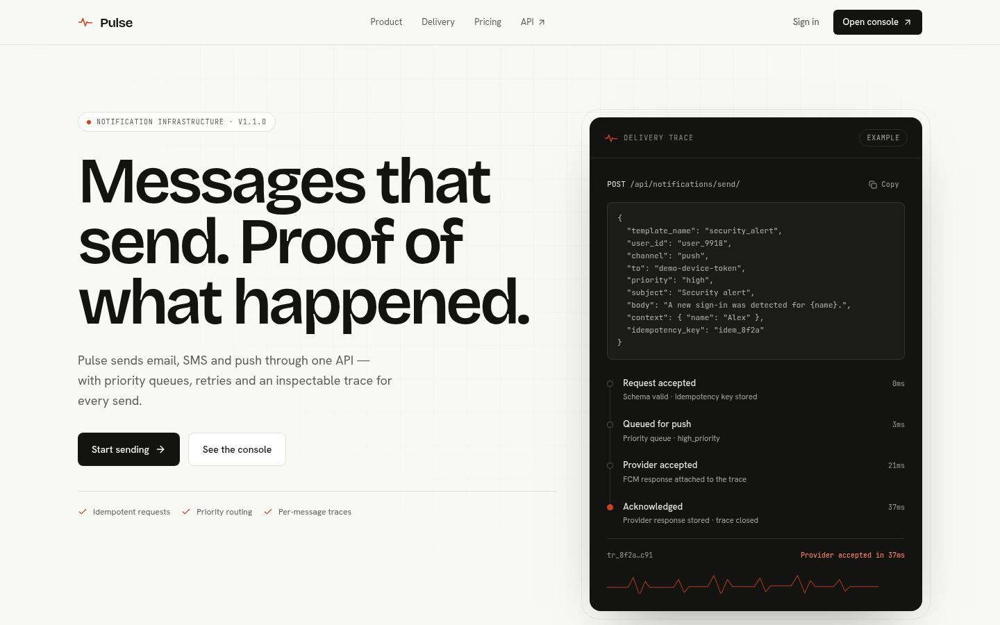
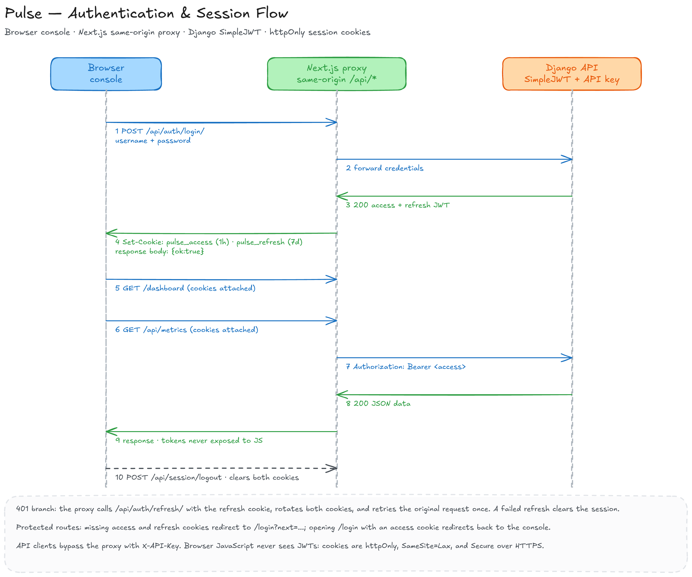
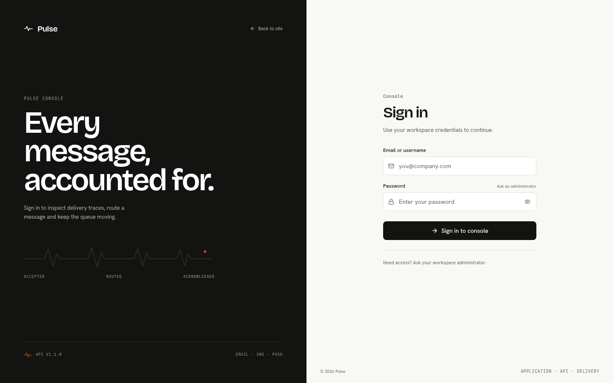
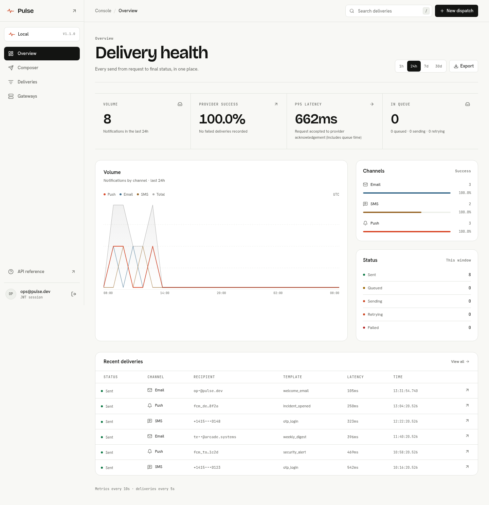
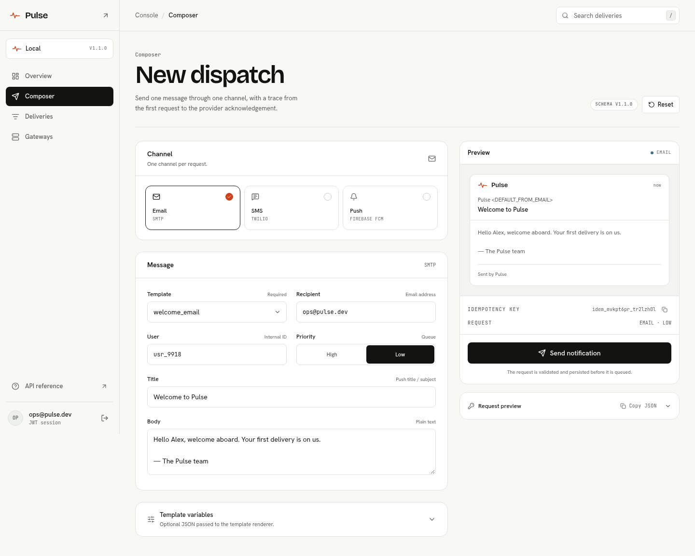
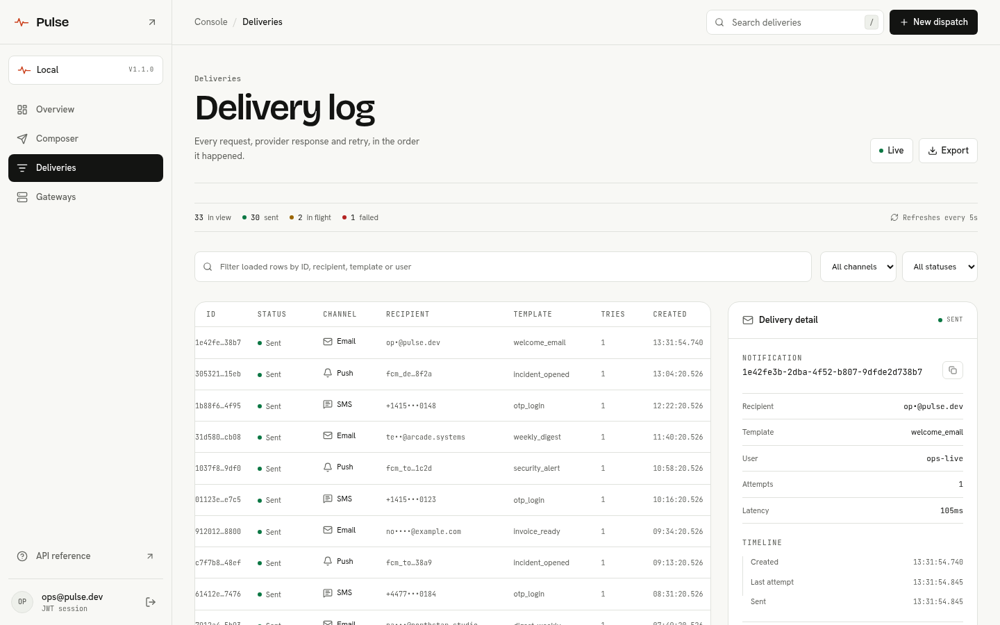
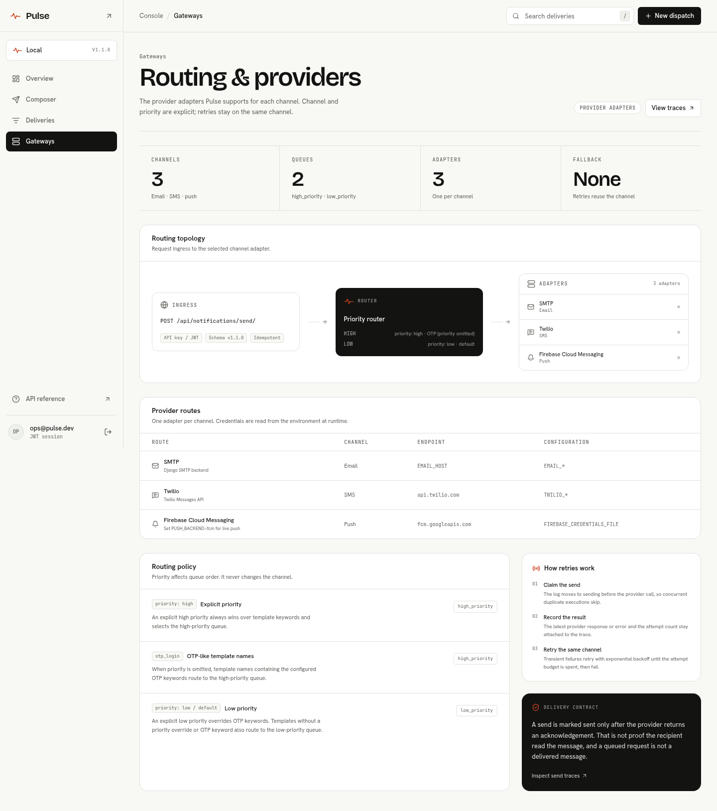
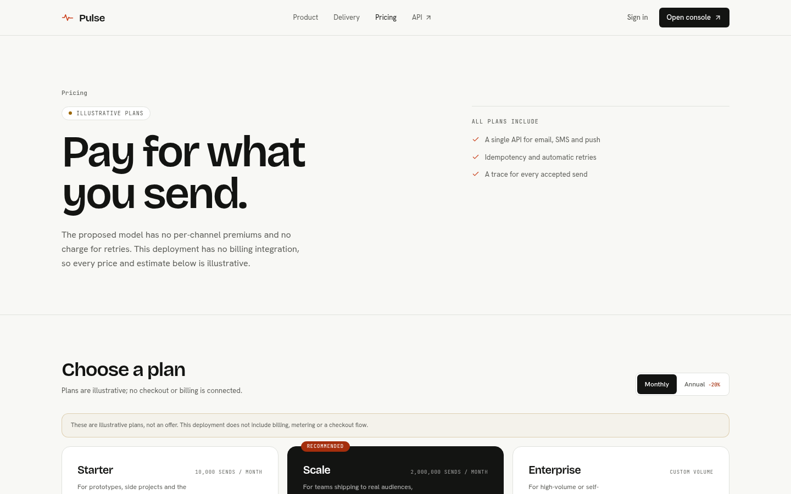
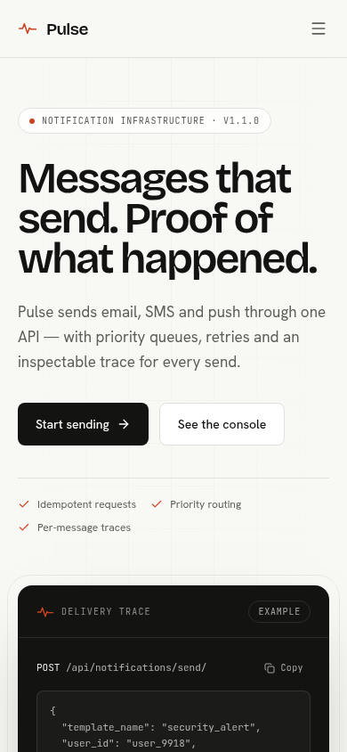
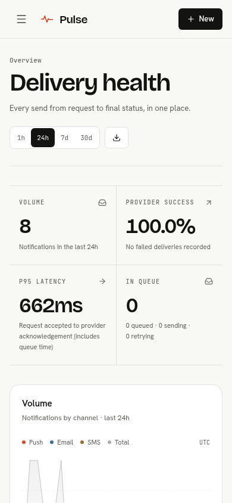

# Pulse Web Console

The public site and operations console share one interface system: a porcelain
canvas, ink typography, hairline structure and a single vermilion signal colour.
Dark panels are reserved for request traces and machine output. Design tokens
and component rules live in [`DESIGN.md`](../DESIGN.md).

> **About the captures:** the screenshots were taken against a local Pulse
> instance with local test deliveries so tables and charts are populated. They
> are not production traffic. When the API is unavailable, affected panels fall
> back to labelled **Sample** data; successful empty responses show empty states,
> not invented traffic.

## Landing page

The public entry point explains the actual contract: one request, one channel,
priority queues, retries on the same channel and an inspectable send trace. It
does not claim automatic channel fallback, a dead-letter queue or delivery to a
human.

[Open the full-page landing capture](images/web-landing.png)

## Sign in

The console entry screen uses the Next.js same-origin proxy. Login accepts an
email address or username; JWTs are stored in httpOnly cookies and are never
returned to browser JavaScript. There is no demo-token bypass.

_Editable source: [auth-session-flow.excalidraw](diagrams/auth-session-flow.excalidraw)._

## Delivery health

The overview combines volume, provider-success, p95 latency, queue status,
channel health, status breakdown and recent deliveries. The window selector
requests a real `/api/metrics?window=1h|24h|7d|30d` payload. Charts and channel
rows are derived from the returned series and per-channel rows; the labels say
**Sample** only when that request fails before any live data has loaded.

The recent-deliveries table is a separate live request. If it fails, only that
table is labelled Sample. If an earlier response exists, the table keeps it and
shows a stale-data warning instead. A failed metrics refresh likewise keeps the
last successful payload and says it is showing the last successful response.
There is no hardcoded success-rate or latency number.

## Dispatch composer

The composer maps directly to the API contract: one request, one channel. A
channel switch updates the recipient hint and preview; the template list comes
from the templates endpoint. The preview substitutes simple placeholders from
the JSON context, while the API renders the real request with Python
`str.format` and rejects missing variables. If the template request fails, sample
templates are labelled **Sample templates** and sending is disabled rather than
dispatching a guessed template. A successful empty template list shows an empty
state with sending disabled.

The form keeps the send action and preview on the right rail at desktop widths
and collapses to a single column on mobile. The generated idempotency key and
request JSON update as the form changes; the JSON preview shows the raw payload
the browser submits. The composer sends through the authenticated console
session; it does not expose an API key to client code.

## Delivery log

The delivery log shows status, channel, recipient, template, attempts and
timestamp, with a detail panel for the selected notification. Channel and status
filters query the API; search filters the latest 50 loaded rows. In the
request-failure sample state, channel and status filters apply to the labelled
sample rows locally. The page refreshes on a fixed interval and can be paused.
A failed poll keeps the last known rows, shows a warning instead of claiming
they are live, and changes the poll control to **Retrying**. `sending` is a
first-class status alongside `pending`, `retrying`, `sent` and `failed`.

The detail panel exposes the notification ID, template, user, attempts, latency,
timeline and idempotency key. Copy controls are available for identifiers.

## Gateways and routing

The gateways screen documents the supported adapters (SMTP, Twilio and FCM),
the two real Celery queues (`high_priority` and `low_priority`) and the retry
policy. It explicitly states that there is no automatic channel failover. It
shows environment-variable names, not credentials.

## Pricing

The pricing page is explicitly labelled **Illustrative plans**. No billing
integration, checkout, invoice, hard cap or metering exists in this deployment.
The estimator uses the proposed Scale base of `$399/month` billed annually (or
`$499` monthly) plus `$0.06` per 1,000 accepted sends above 2,000,000. Starter
shows `$0` at or below 10,000 accepted sends. The breakdown displays base plan,
included volume, additional sends and overage.

[Open the full-page pricing capture](images/web-pricing.png)

## Responsive layout

The same content hierarchy is preserved on small screens: navigation moves into
a drawer, KPI cells stack into a readable grid, tables drop technical columns and
the composer becomes a single-column form.

| Mobile landing                                        | Mobile dashboard                                                     |
| ----------------------------------------------------- | -------------------------------------------------------------------- |
|  |  |

The captures were taken at `390 × 844`. Desktop captures use a `1440px` wide
viewport.
